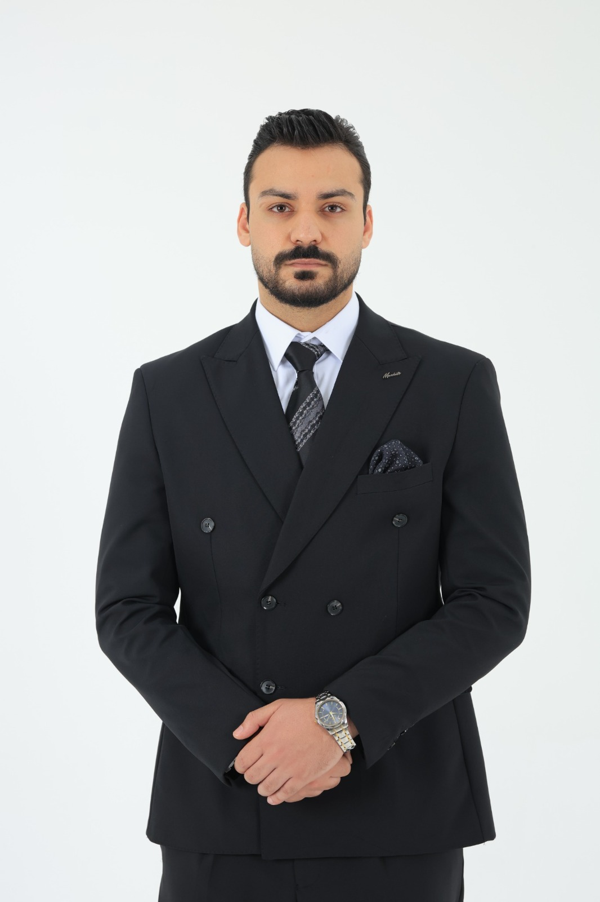

# Bashar Ghassan Alzaq — Portfolio

A responsive personal portfolio built from scratch
using HTML5, CSS3, and vanilla JavaScript.

## Sections

- Home: profile photo, name, and professional summary
- About and education
- Technical skills
- Academic projects
- Professional training and experience
- Certifications
- Hobbies
- Contact information and email form

## Technologies

- HTML5
- CSS3
- Flexbox and CSS Grid
- CSS media queries
- JavaScript ES6+
- Git

## Features

- Responsive design for desktop, tablet, and mobile
- Dark theme switcher
- Navigation links to page sections
- Contact form that prepares an email
- Automatically updated footer year

## Run locally

Open `index.html` in a modern web browser.
No package installation is required.

## Profile photo

Save your photo as:

`assets/profile.jpg`

The HTML uses this path:

```html

```

## Contact form

The contact form opens the visitor's default email
application with the message filled in. It does not
send or store submissions on a server.

## Content

Education, skills, experience, and certifications are
based on the supplied CV. Add actual project links or
screenshots when available.
